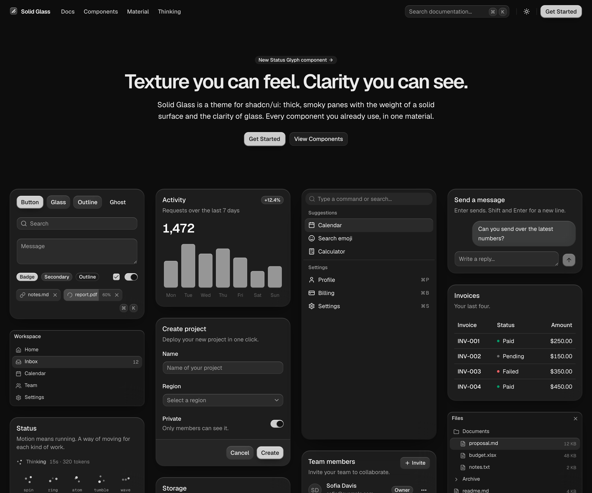
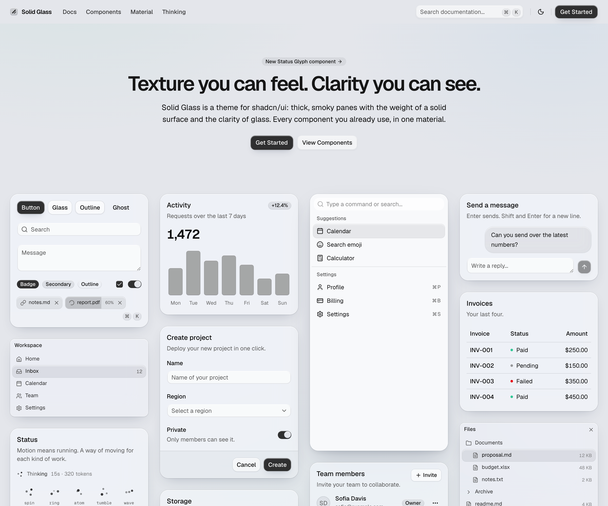
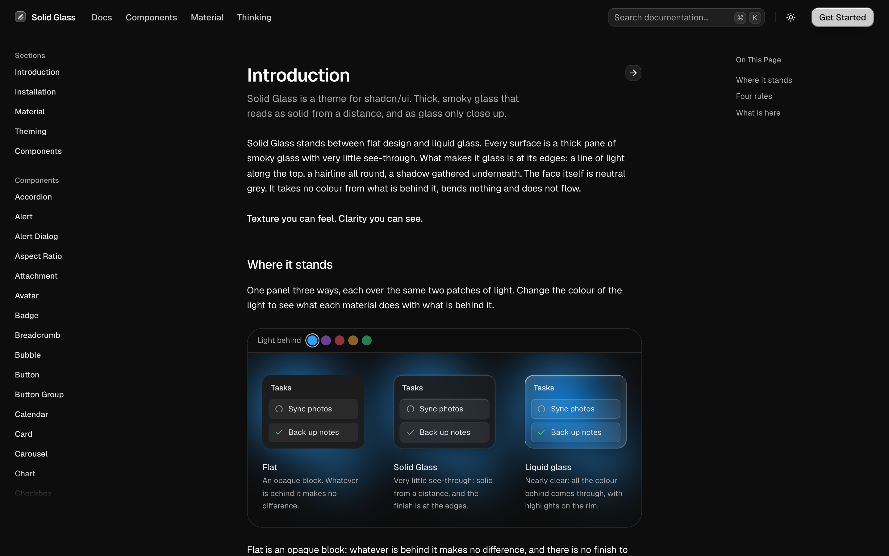

# Solid Glass

A theme for [shadcn/ui](https://ui.shadcn.com): thick, smoky panes of glass that read as solid from
a distance and as glass only close up. The finish is at the edges (a line of light along the top, a
hairline all round, a shadow gathered underneath); the face is neutral grey, takes no colour from
what is behind it, bends nothing and does not flow.

**[waylandyang.github.io/solid-glass](https://waylandyang.github.io/solid-glass)** shows every
shadcn/ui component in the material, plus a dozen components of Solid Glass's own.





It stands between flat design and liquid glass. Flat is an opaque block with no finish to speak of;
liquid glass is nearly clear, and on a page with a lot of text the reader is always fighting the
background for the words. Solid Glass lets only an outline through: enough to know it is glass, not
enough to get in the way of reading.



## Install

Solid Glass is one stylesheet. It finds each part of a shadcn/ui component by the `data-slot` and
the classes it already carries, so the components you have need no changes.

Start from a shadcn/ui project (React 19, Tailwind CSS 4, the Base UI components):

```bash
npx shadcn@latest init
```

Add the stylesheet, from the site or straight from this repository:

```bash
npx shadcn@latest add https://waylandyang.github.io/solid-glass/r/solid-glass.json
npx shadcn@latest add WaylandYang/solid-glass/solid-glass
```

Import it after Tailwind and shadcn's stylesheet, and delete the `:root` and `.dark` colour
variables that `shadcn init` wrote (Solid Glass defines the same names):

```css
@import "tailwindcss";
@import "tw-animate-css";
@import "shadcn/tailwind.css";
@import "./solid-glass.css";
```

Dark is the material as designed; light is there too. The
[installation page](https://waylandyang.github.io/solid-glass/docs/installation) has the rest.

Solid Glass's own components install the same way:

```bash
npx shadcn@latest add https://waylandyang.github.io/solid-glass/r/status-glyph.json
```

| Component | What it is |
|---|---|
| `status-glyph` | Three points of light that say a turn is going, and what it is doing. |
| `panel`, `tag`, `dot-loader` | The thinnest pane, a small label, and a row of dots that waits. |
| `turn-status`, `composer`, `tool-steps`, `diff-view`, `ask-card`, `context-ring`, `task-notice`, `reasoning` | For interfaces where an agent works: its status line, the box you write to it in, the steps it took, a diff, a question it asks, how full its context is, a notice from a task, and its thinking. |

## What is here

| Path | What it is |
|---|---|
| `src/solid-glass.css` | The theme. The whole material in one file: colours, the three thicknesses of glass, the one state, motion. It defines shadcn/ui's own variable names. |
| `registry.json` | The registry: what `shadcn add` installs from. Written by `scripts/build-registry.mjs`, which also builds `public/r/` for the site. |
| `src/components/ui/` | The components the site shows. shadcn/ui's (Base UI, `base-nova`), installed with its command line, and Solid Glass's own. A few of shadcn/ui's (`button`, `input`, `tabs`, `dialog`, `dropdown-menu`, `sheet`, `sidebar` and some form controls) differ from stock in small ways; the stylesheet does not depend on those differences. |
| `src/examples/` | One small file per example, as on ui.shadcn.com: shadcn/ui's own examples, and Solid Glass's for its own components. |
| `content/` | The documentation. `components/` is shadcn/ui's page for each component; `solid/` and `docs/` are Solid Glass's. |
| `src/site/`, `src/pages/`, `src/home/` | The site: header, sidebar, component preview, and the wall of cards on the home page. |
| `scripts/build-docs.mjs` | Turns `content/` into `src/docs/generated.json`, which the site renders. |

## Run

```bash
npm install
npm run dev         # http://localhost:5191
npm run build       # into dist/
npm run typecheck
```

`/dev/examples` (development only) mounts every example at once and lists any that fail. It takes
`?q=button,card` to show some of them, `?theme=light`, `?hover=<selector>` to show what matches as
if the pointer were on it, and `?click=<selector>` to press something and look at what it opens.

`SOLID_GLASS_ORIGIN` is the address the site is served from (Solid Glass's own components name one
another by it) and `SOLID_GLASS_BASE` the path it lives under there; the defaults are this
repository's GitHub Pages.

## Add a component of Solid Glass's own

1. `src/components/ui/<name>.tsx`, written like a shadcn/ui component: function components, a
   `data-slot` on every part, `cn()` from `@/lib/utils`.
2. `src/examples/<name>-demo.tsx`, and one file per further example.
3. `content/solid/<name>.mdx`: front matter (`title`, `description`), then
   `<ComponentPreview name="<name>-demo" />`, Installation, Usage, and a heading per example.

Keep to the four rules (the Material page shows them): the finish is at the edge; heavy, not airy;
depth is thickness; one state.

## Licence

[MIT](LICENSE). The components, examples and component documentation that come from shadcn/ui are
its authors', also under the MIT License: see [NOTICE.md](NOTICE.md).
